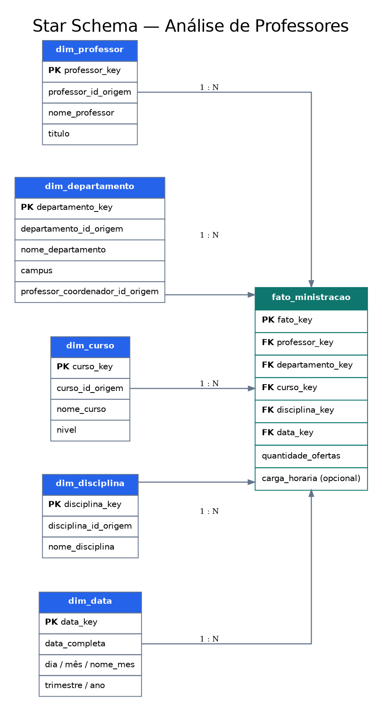

# Star Schema — Análise de Professores

Projeto para o desafio de modelagem dimensional da formação Power BI Analyst.

## Enunciado seguido

Embora o título exibido na plataforma DIO mencione cenários de vendas, o vídeo e o documento de instruções dessa atividade apresentam um modelo universitário: **professores como objeto de análise**, com departamentos, cursos, disciplinas e uma dimensão de datas. Este projeto segue o conteúdo explicado no vídeo e descrito no documento disponibilizado.

## Objetivo

Modelar um esquema estrela para analisar ofertas/atribuições de disciplinas por professor, curso, departamento e data. O enunciado pede uma tabela fato, dimensões com detalhes do contexto e uma dimensão de datas; informa ainda que não é necessário modelar dados de alunos.

## Ferramentas

- MariaDB e DBeaver para criar e validar a estrutura SQL.
- Power BI para a etapa de modelagem/visualização, se disponível.
- Mermaid para documentar o diagrama dimensional.

## Granularidade proposta

**Uma linha da tabela fato representa a oferta/atribuição de uma disciplina a um professor, em um curso, departamento e data.** O enunciado não determina uma granularidade exata; esta é uma proposta documentada para tornar o modelo implementável.

## Estrutura do projeto

- `01_criar_star_schema.sql`: cria as dimensões e a tabela fato.
- `02_dados_demonstracao.sql`: carrega dados fictícios apenas para testar o modelo. Substitua-os por dados reais quando disponíveis.
- `03_consultas_validacao.sql`: consultas de validação e análise.
- `diagrama_star_schema.mmd`: diagrama em Mermaid.

## Diagrama dimensional

Arquivos do diagrama: [SVG](diagrama_star_schema.svg) (visualização vetorial), [DOT](diagrama_star_schema.dot) (fonte editável do Graphviz) e [Mermaid](diagrama_star_schema.mmd).

A tabela fato referencia cada dimensão diretamente. As dimensões não se relacionam diretamente entre si, mantendo o padrão estrela.

## Dimensões e medidas

- `dim_professor`: identificador de origem e atributos descritivos disponíveis.
- `dim_departamento`: identificador, nome, campus e identificador de coordenador, quando disponíveis.
- `dim_curso`: identificador de origem e nome do curso, quando disponível.
- `dim_disciplina`: identificador de origem e nome da disciplina, quando disponível.
- `dim_data`: data, dia, mês, trimestre e ano.
- `fato_ministracao`: chaves para as dimensões, quantidade de ofertas e carga horária opcional.

## Como executar no MariaDB / DBeaver

1. Abra `01_criar_star_schema.sql` no DBeaver, selecione a conexão MariaDB e execute o script inteiro. **Atenção:** o script recria as tabelas deste esquema e elimina as tabelas homônimas que já existirem no banco `star_schema_professores`.
2. Execute `02_dados_demonstracao.sql` para testar com linhas **fictícias/demonstrativas**. Execute esse arquivo uma única vez em uma base vazia ou limpe os dados demonstrativos antes de repeti-lo.
3. Execute `03_consultas_validacao.sql` e confira os resultados.
4. No Power BI, quando disponível, conecte à fonte e carregue a tabela fato e suas dimensões. Relacione cada dimensão à tabela fato pela respectiva chave substituta.

## Limitações e decisões

O diagrama relacional de referência não apresenta dados reais de ofertas, datas ou carga horária. A granularidade escolhida é uma proposta implementável: uma linha por combinação de professor, departamento, curso, disciplina e data. As datas e os registros do arquivo de demonstração são fictícios e servem apenas para testar as relações; não representam dados institucionais.

A integração e o relatório do Power BI ainda precisam ser concluídos e validados separadamente. Os scripts SQL e o diagrama documentam a proposta de modelagem, mas não comprovam a criação de um arquivo `.pbix` ou de um dashboard.
